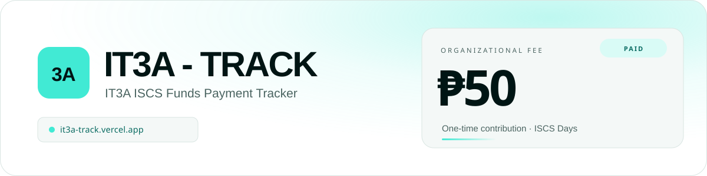

<div align="center">
  <picture>
    <source media="(prefers-color-scheme: dark)" srcset="docs/readme-banner-dark.svg">
    <source media="(prefers-color-scheme: light)" srcset="docs/readme-banner-light.svg">
    
  </picture>

  <p>
    <a href="https://it3a-track.vercel.app"></a>
    
    
    
  </p>
</div>

<p align="center">
  <a href="https://it3a-track.vercel.app"><strong>it3a-track.vercel.app</strong></a><br>
  <sub><strong>IT3A ISCS Funds Payment Tracker</strong> · Paid-only public ledger for the ₱50 organizational fund.</sub>
</p>

IT3A - TRACK is the payment tracker for the IT3A organizational fund for the upcoming
ISCS Days. Every student in the section owes a one-time ₱50 contribution. One shared roster
answers two different questions: the class can see who has already paid, and the two
administrators can see who has not.

<p align="center">
  <a href="#what-it-does">What it does</a> ·
  <a href="#design">Design</a> ·
  <a href="#security-model">Security</a> ·
  <a href="#deploying-to-vercel">Deploy</a> ·
  <a href="#troubleshooting">Troubleshooting</a>
</p>

**At a glance**

- **Live app:** [it3a-track.vercel.app](https://it3a-track.vercel.app).
- **Who pays:** every student in IT3A.
- **Fee:** ₱50, one-time, for the ISCS Days organizational fund.
- **Public page:** paid students only, their merit numbers, plus the running total collected.
- **Admin dashboard:** the full roster, including unpaid students, remarks, merit numbers, and
  payment history.
- **Administrators:** Dexter Gravoso and Troy Lagahit. Their login identifiers live in
  `.env.local`, not in this repository, because the repository is public.
- **Currency:** Philippine peso (₱).
- **Hosting:** Supabase for Postgres and Auth, Vercel for the app.

## Why the public page hides unpaid students

Naming a classmate over an unpaid ₱50 before ISCS Days is not the point of this system. The
public page works like a receipt board: it confirms who has paid and shows the fund growing.
The unpaid list is a private working document for the two administrators, who need it to
follow up individually. No enrollment count, unpaid count, percentage, or progress bar is
ever exposed publicly, so the page cannot be used to rank or shame anyone by absence.

---

## What it does

**Public page (`/`)**

- "N Students Paid" and "₱N Collected" headline figures, computed from the database on every request.
- Leaderboard of paid students: rank, full name, merit number when recorded, green PAID badge,
  payment date.
- Search by name or merit number, plus payment-order / A-Z / Z-A sorting.
- Empty state reads "0 Students Paid" and "₱0 Collected".
- Total enrollment, unpaid counts, percentages, and progress bars are **never** exposed.

**Login (`/login`)**

- One form: username or email, password, Login. Optional show/hide password.
- One generic error for a wrong username or a wrong password.
- No sign-up, no registration link, no public account creation. There is no self-service
  password reset because no mail provider is configured; an administrator password is reset by
  re-running `npm run setup:admins`.

**Admin dashboard (`/admin`)**

- Private totals: collected, paid, unpaid, and roster size.
- Full roster with remarks, payment dates, merit numbers, status filter, and search.
- Mark paid / mark unpaid, add, edit, and delete (with a confirmation dialog). Marking paid
  opens a small dialog where an optional merit number can be recorded.
- Payment history: who changed what, and when.
- Sign out clears the session cookies.

**Money rules**

- The fee is fixed at ₱50 per student for the ISCS Days organizational fund and is not stored
  per student.
- `Total Collected = paid_count × 50`, always derived from the rows.
- Marking paid adds ₱50; marking unpaid removes ₱50. There is no stored total to drift.
- A database trigger stamps `payment_date` when a student becomes paid and clears it when
  they are reverted. The history survives in the audit log.
- A merit number is optional. It appears on the public leaderboard, can only exist on a paid
  student, and is cleared when a student is marked unpaid.
- Duplicate names are rejected case- and whitespace-insensitively.

---

## Collecting the fee

1. Load the section roster once, from the dashboard or with
   `npm run import:students -- --file roster.csv`.
2. Send the public link to the class. A student checks that their name appears after paying.
3. As cash comes in, an administrator marks each student paid. The payment date is stamped
   automatically, the total moves by ₱50, and an optional merit card number can be recorded in
   the same step.
4. If a payment is refunded or recorded by mistake, mark the student unpaid. The total drops
   by ₱50 and the correction stays in the payment history.
5. Before ISCS Days, filter the dashboard roster to unpaid. That filtered list is the
   follow-up list.

---

## Stack

| Layer    | Choice                                                       |
| -------- | ------------------------------------------------------------ |
| UI       | Next.js 15.5 (App Router), React 19, TypeScript              |
| Styling  | Tailwind CSS 4 with custom design tokens                     |
| Data     | Supabase Postgres, Row Level Security, Supabase Auth         |
| Hosting  | Vercel (or any Node host that runs Next.js)                  |

Palette: `#FFFFFF` canvas, `#41EAD4` accent, `#001514` ink.
Type: Outfit for text, JetBrains Mono for figures.

---

## Design

<div align="center">
  
</div>

| Token | Value | Role |
| --- | --- | --- |
| Canvas | `#FFFFFF` | Page surfaces, with cool neutral steps for layering |
| Accent | `#41EAD4` | PAID state, focus rings, the hero sheen, and primary actions |
| Ink | `#001514` | Type, inverse cards, and the dark canvas |

Dark mode derives its neutrals from the same three colours; the accent never changes. A theme
button beside Admin Login overrides the system preference and remembers the choice on the device.
Motion is limited to entry reveals and collapses under `prefers-reduced-motion`. Cards use 16px
radii, controls use 10px, and figures are set in JetBrains Mono.

---

## 1. Create the Supabase project

1. Go to <https://supabase.com/dashboard> and create a new project.
2. Open **Project Settings -> API** and copy:
   - Project URL
   - `anon` public key
   - `service_role` secret key
3. Open **Project Settings -> Database -> Connection string -> URI** and copy the connection
   string. If the password contains `@`, `:`, `/` or `#`, percent-encode it (`@` becomes `%40`).

## 2. Configure the environment

```bash
cp .env.example .env.local
```

Fill in `.env.local`:

| Variable                        | Used by                          | Notes                                     |
| ------------------------------- | -------------------------------- | ----------------------------------------- |
| `NEXT_PUBLIC_SUPABASE_URL`      | app and scripts                  | Safe to expose                            |
| `NEXT_PUBLIC_SUPABASE_ANON_KEY` | app, RLS enforced                | Safe to expose                            |
| `SUPABASE_SERVICE_ROLE_KEY`     | server actions and scripts only  | **Never** expose; bypasses RLS            |
| `DATABASE_URL`                  | `npm run migrate`                | Direct or pooler Postgres URI             |
| `IT3A_ADMIN_1_*`                | `npm run setup:admins`           | Dexter Gravoso                            |
| `IT3A_ADMIN_2_*`                | `npm run setup:admins`           | Troy Lagahit                              |

`.env.local` is gitignored. Passwords live only there and are hashed by Supabase Auth; they are
never written to the database, the client bundle, or the console.

## 3. Install, migrate, provision

```bash
npm install
npm run migrate          # applies supabase/migrations/*.sql in order
npm run setup:admins     # creates the two Auth users and links them to it3a_admins
```

`setup:admins` is idempotent. Re-running it resets both passwords to the values in `.env.local`
and repairs a renamed email. It never prints a password.

## 4. Add the roster

Either add students one at a time from the dashboard, or import a CSV:

```bash
npm run import:students -- --file roster.csv
npm run import:students -- --file roster.csv --dry-run
```

```csv
full_name,payment_status,remarks,merit_number
Juan Miguel Dela Cruz,paid,Paid in cash,MC-0142
Ana Sofia Reyes,unpaid,,
```

Only `full_name` is required. Importing the same file twice updates rows instead of duplicating
them. If the file includes a `merit_number` column, it is applied to paid students only and
ignored for unpaid rows. See `roster.sample.csv`. Unpaid rows stay private; the public page only
ever reads the paid ones.

## 5. Run it

```bash
npm run dev
```

- Public page: <http://localhost:3000>
- Login: <http://localhost:3000/login>
- Production: <https://it3a-track.vercel.app>

---

## Security model

All access control lives in Postgres. The UI is a convenience layer.

| Role            | Can do                                                                                       |
| --------------- | -------------------------------------------------------------------------------------------- |
| `anon`          | Read **paid** rows only, and only `id, full_name, payment_status, payment_date, merit_number, created_at`. Never `remarks`, never unpaid rows. |
| `authenticated` | Full roster access **only** when `it3a_is_admin()` finds the user in `it3a_admins`.            |
| `service_role`  | Server-side only. Used by the login action to resolve username to email and by provisioning scripts. |

- Column-level grants mean `select=remarks` from the public fails, even for a paid student.
  Merit numbers are public for paid students, and unpaid rows cannot hold one.
- `it3a_admins` is readable only row-by-row by the signed-in administrator themself.
- `it3a_payment_audit_log` is read-only for administrators. Writes come from a
  `SECURITY DEFINER` trigger, so no client can forge history.
- `it3a_signup_allowlist` has no grants for any client role.
- The public page has no query that could reveal how many students are on the roster.
- Only two rows may exist in `it3a_admins`; provisioning deletes stale duplicates.

### Disable public registration at the provider level

In the Supabase dashboard go to **Authentication -> Sign In / Providers -> Email** and turn off
**Allow new users to sign up**. Also check **Authentication -> Settings** for any signup-related
toggles.

Migration `0003_signup_lockdown.sql` adds a second, database-level gate: a trigger on
`auth.users` rejects any new user whose email is not present in `it3a_signup_allowlist`.
`setup:admins` writes the allowlist row **before** creating the account, so the two real admins
pass and everyone else is blocked. This migration is intended for a project dedicated to this
app, because the trigger applies to the whole `auth.users` table.

### Rate limiting

The login action allows 8 attempts per IP per minute. This is a per-instance in-memory window on
top of Supabase Auth's own throttling; it blunts casual brute force rather than stopping a
distributed attack.

---

## Deploying to Vercel

1. Push the project to a Git repository.
2. In Vercel, **Add New -> Project** and import the repository. The Next.js preset is correct.
3. Add these environment variables for Production, Preview, and Development:
   `NEXT_PUBLIC_SUPABASE_URL`, `NEXT_PUBLIC_SUPABASE_ANON_KEY`, `SUPABASE_SERVICE_ROLE_KEY`.
   Do not add `DATABASE_URL` or the `IT3A_ADMIN_*` variables; those are local-only.
4. Run the migrations and provisioning against the production database from your machine, using
   the production values in `.env.local`:

   ```bash
   npm run migrate
   npm run setup:admins
   ```

5. Deploy to <https://it3a-track.vercel.app>. Then confirm:
   - `/` shows the paid leaderboard.
   - `/admin` redirects to `/login` when signed out.
   - Both administrators can sign in and one can mark a student paid.
6. Share <https://it3a-track.vercel.app> with IT3A and give the two administrator logins to
   Dexter and Troy only.

Any Node host that supports Next.js 15 works the same way; the server actions need a Node
runtime, which is the default.

---

## Troubleshooting

### `getaddrinfo ENOTFOUND db.<ref>.supabase.co`

Newer Supabase projects publish an **IPv6-only** direct connection host. On a network without
IPv6 (most home and office networks), that hostname cannot resolve. Use the pooler instead:

**Dashboard -> Connect -> Connection string -> Session pooler**, then copy the URI. It looks like:

```
postgresql://postgres.<project-ref>:<password>@aws-0-<region>.pooler.supabase.com:5432/postgres
```

Two differences from the direct string:

- the username is `postgres.<project-ref>`, not `postgres`
- the password is URL-encoded, so `@` becomes `%40`, `#` becomes `%23`, `/` becomes `%2F`

`npm run migrate` prints these instructions automatically when it sees this error.

### `password authentication failed`

The pooler and the direct connection use different usernames (see above). If the username is
right, reset the database password in **Project Settings -> Database** and re-copy the URI.

### `Tenant or user not found`

The username is missing the project ref, or `DATABASE_URL` points at the pooler of a different
region. Copy the string from the dashboard rather than assembling it.

### A student paid but is not on the public page

Check the roster in the dashboard. The public page only lists rows with `payment_status = paid`,
and the database trigger sets `payment_date` at the moment the status changes. Marking the
student paid from the dashboard is the only supported way to appear there.

---

## Scripts

| Command                                   | Purpose                                                     |
| ----------------------------------------- | ----------------------------------------------------------- |
| `npm run dev`                             | Development server                                          |
| `npm run build` / `npm start`             | Production build and serve                                  |
| `npm run typecheck`                       | TypeScript, no emit                                         |
| `npm run migrate`                         | Apply `supabase/migrations/*.sql` in filename order          |
| `npm run migrate -- --exclude=0003`       | Apply everything except the signup lockdown (shared projects) |
| `npm run setup:admins`                    | Create or repair the two administrator accounts             |
| `npm run import:students -- --file x.csv` | Import or update a roster from CSV                          |

## Data model

```
it3a_students          id, full_name, payment_status, payment_date, remarks, merit_number,
                       created_at, updated_at
it3a_admins            id -> auth.users, username, email, full_name, created_at
it3a_signup_allowlist  email, username, full_name, created_at
it3a_payment_audit_log id, student_id (no FK), student_name, admin_id, admin_username,
                       previous_status, new_status, changed_at
```

- `payment_status` is `paid` or `unpaid`; a check constraint keeps `payment_date` consistent
  with it.
- `merit_number` is optional, at most 40 characters, and may only be set on a paid student. It is
  public on the leaderboard. The trigger clears it on revert, so an unpaid row can never keep a
  stale merit number.
- `full_name` has a unique index on `lower(btrim(full_name))`.
- `student_id` in the audit log deliberately has no foreign key, so history outlives deletions.
- Amounts are never stored.

## Project layout

```
app/
  page.tsx                 public leaderboard
  login/                   login page and form
  admin/                   protected dashboard
  globals.css              design tokens, dark-mode overrides, motion
components/
  public/                  header, leaderboard
  admin/                   dashboard, dialogs, sign out
  ui/                      button, field, modal primitives
lib/
  actions/                 server actions (auth, students)
  queries/                 public and admin read paths
  supabase/                browser, server, and service clients
  auth.ts                  requireAdmin / getAdminProfile
supabase/migrations/       0001 schema, 0002 RLS, 0003 signup lockdown, 0004 merit number,
                           0005 public merit column
scripts/                   migrate, setup-admins, import-students
docs/                      README banner and palette artwork
```

## Resetting an administrator password

1. Set the new value for `IT3A_ADMIN_1_PASSWORD` or `IT3A_ADMIN_2_PASSWORD` in `.env.local`.
2. Run `npm run setup:admins`.

Nothing else changes; the dashboard data is untouched.

---

<div align="center">
  <sub><strong>IT3A - TRACK</strong> · IT3A ISCS Funds Payment Tracker · ₱50 organizational fund for ISCS Days</sub><br>
  <sub><a href="https://it3a-track.vercel.app">it3a-track.vercel.app</a></sub>
</div>
